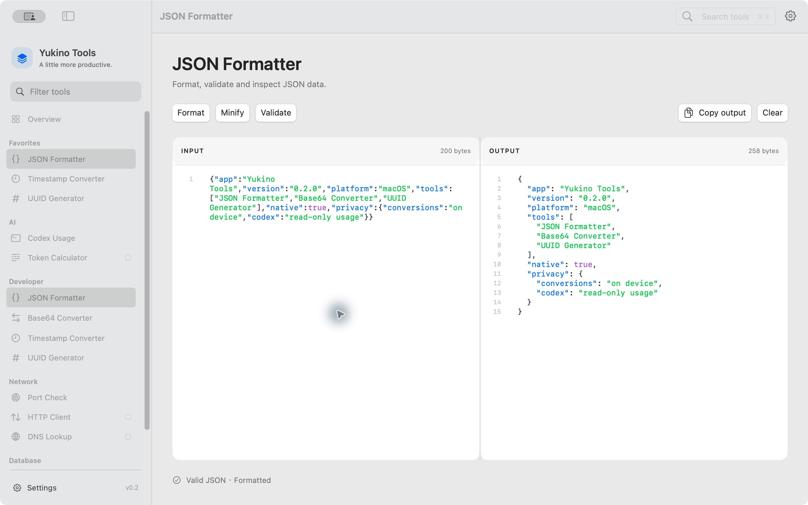
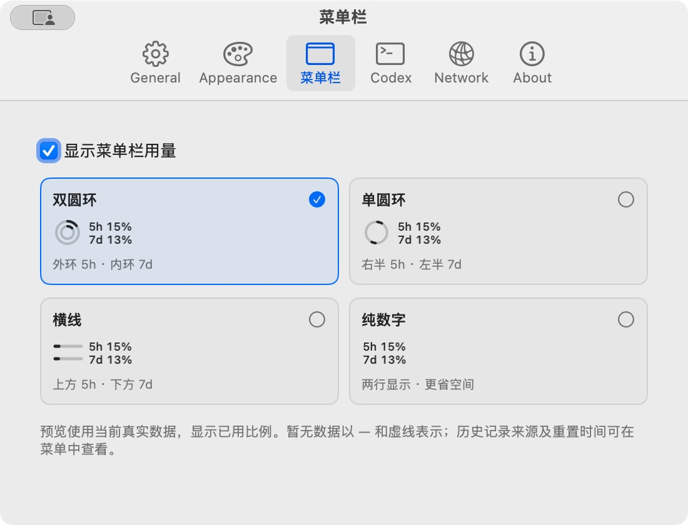
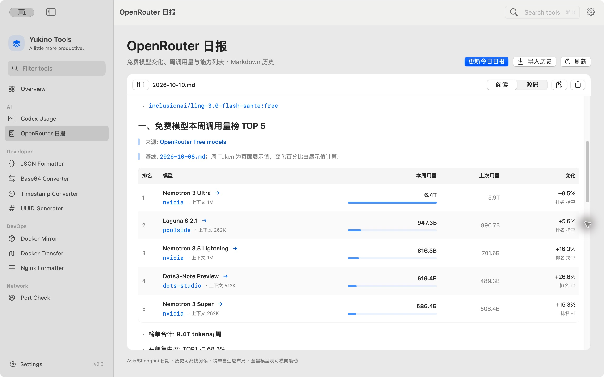
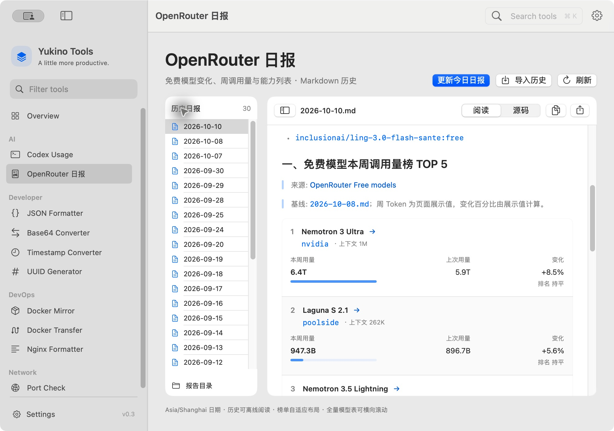
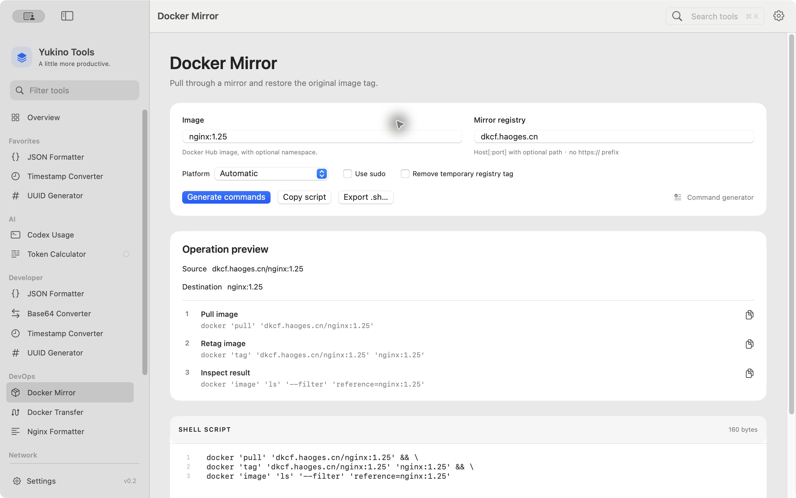
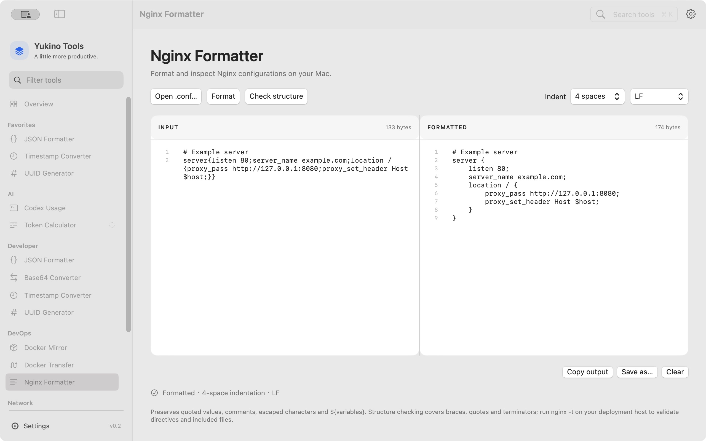
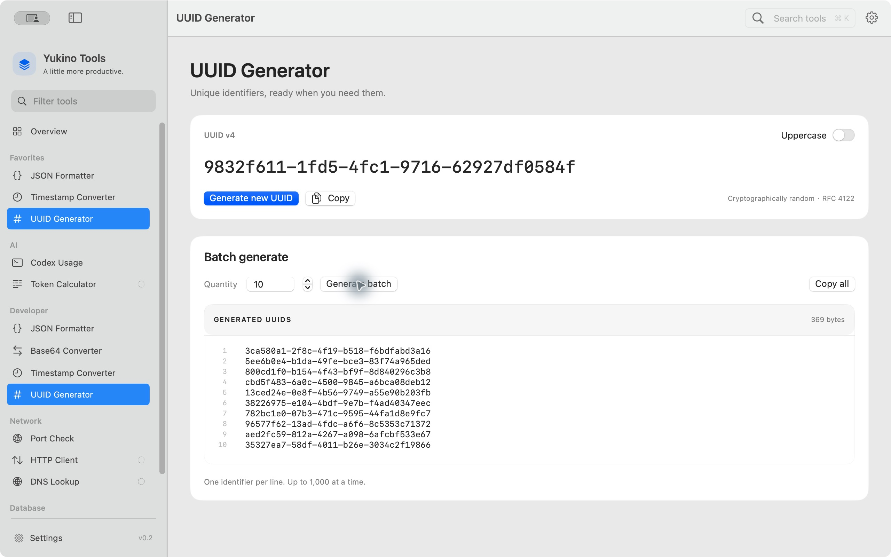

<div align="center">

# Yukino Tools

**A little more productive.**

原生 macOS 开发工具箱：日常转换、网络检测、DevOps 命令、Codex 用量和 OpenRouter 日报，一个 App 搞定。

[](https://github.com/Yukino-7/Yukino-Tools/releases/latest) [](Package.swift) [](https://github.com/Yukino-7/Yukino-Tools/releases/latest) [](LICENSE)

[下载安装](#下载安装) · [功能概览](#功能概览) · [使用指南](#使用指南) · [数据与隐私](#数据与隐私) · [开发与构建](#开发与构建)

</div>



## 下载安装

当前版本：**[v0.4.1](https://github.com/Yukino-7/Yukino-Tools/releases/tag/v0.4.1)**。要求 **macOS 14+**，安装包适用于 **Apple Silicon（M 系列芯片）**。

| 下载 | 安装方式 |
| --- | --- |
| [DMG 安装包](https://github.com/Yukino-7/Yukino-Tools/releases/download/v0.4.1/Yukino-Tools-0.4.1-macos-arm64.dmg) | 打开后，将 **Yukino Tools.app** 拖到 **Applications** |
| [ZIP 压缩包](https://github.com/Yukino-7/Yukino-Tools/releases/download/v0.4.1/Yukino-Tools-0.4.1-macos-arm64.zip) | 解压后，将应用放入 **Applications** |
| [SHA-256 校验文件](https://github.com/Yukino-7/Yukino-Tools/releases/download/v0.4.1/SHA256SUMS.txt) | 将对应文件的哈希与校验文件比对 |

```sh
shasum -a 256 Yukino-Tools-0.4.1-macos-arm64.dmg
```

将输出与校验文件中的同名条目比对；下载 ZIP 时，将命令中的文件名替换为对应 ZIP 文件名。

安装包目前使用 **ad hoc 签名**，尚未经过 Apple Developer ID 签名和公证。首次打开若被 macOS 阻止，确认下载来源后，可按系统提示在“系统设置 → 隐私与安全性”中选择“仍要打开”。

Intel Mac 可[从源码构建](#开发与构建)，暂未提供经过验证的 Intel 安装包。历史版本与变更见 [Releases](https://github.com/Yukino-7/Yukino-Tools/releases) 和 [更新记录](CHANGELOG.md)。

## 功能概览

| 分类 | 工具 | 主要功能 |
| --- | --- | --- |
| AI | **Codex Usage** | 真实账户已用额度、重置时间、本机 Token 与会话统计、缓存率、上下文估算、用量图表 |
| AI | **OpenRouter 日报** | 免费模型变化、每周 Token 用量 TOP 5、榜单对比、Markdown 阅读与导出、历史导入 |
| Developer | **JSON Formatter** | 格式化、压缩、校验、行号、语法高亮、双栏编辑与查找；保留数字精度、键顺序和转义文本 |
| Developer | **Base64 Converter** | UTF-8 编码、解码、交换与复制 |
| Developer | **Timestamp Converter** | 秒/毫秒时间戳与日期双向转换、Local / UTC、实时当前时间戳 |
| Developer | **UUID Generator** | UUID v4、大小写切换、单个与批量生成，单次最多 1,000 个 |
| Network | **Port Check** | TCP 连通性、连接耗时、超时设置与最近端点 |
| DevOps | **Docker Mirror** | 生成镜像代理拉取及恢复原标签的命令，支持平台、sudo 和临时标签清理 |
| DevOps | **Docker Transfer** | 本机与镜像仓库双向迁移的命令生成，支持 host:port、命名空间及分步复制 |
| DevOps | **Nginx Formatter** | 双栏格式化、结构检查、2/4/8 空格缩进、LF/CRLF、UTF-8/Latin-1 文件导入与另存为 |

支持 `⌘K` 搜索工具、收藏与拖动排序、最近使用记录、窗口位置记忆、系统/浅色/深色外观及登录启动设置。侧栏与搜索只展示已实现的工具。

启动时播放约 1.8 秒的「工具汇聚」动画，每次进程启动播放一次；可按 `Esc` 跳过，也支持系统“减少动态效果”。

## 使用指南

### Codex 用量与菜单栏

在侧栏打开 **AI → Codex Usage**。App 会自动检测已安装的 Codex CLI，复用当前 ChatGPT 登录状态，显示账户额度和本机 Token 统计。图表支持 Today / 7 days / 30 days，鼠标悬浮可查看日期、小时段和完整 Token 数。

首次使用若没有数据显示，在 **Settings → Codex** 中检查：

1. Codex CLI 已安装，并已使用 ChatGPT 账户登录。
2. 需要时手动选择 CLI 或本机数据目录，默认读取 `~/.codex`。
3. 点击 **Save & refresh**。默认每 60 秒自动刷新，可调整为 15–300 秒。

**Settings → 菜单栏** 可实时预览和切换用量样式，也可从菜单中的“菜单栏样式”直接切换。选择会自动保存，四种样式都用两行数字显示 **5h / 7d 已用百分比**。

| 样式 | 5h | 7d |
| --- | --- | --- |
| 双圆环（默认） | 外环 | 内环 |
| 单圆环 | 右半环 | 左半环 |
| 横线 | 上方 | 下方 |
| 纯数字 | 第一行 | 第二行 |



窗口缺失或周期未知时显示 `—`，图形使用虚线；菜单中可查看数据来源、更新时间和重置时间。菜单栏图形跟随 macOS 明暗颜色。

### OpenRouter 日报

在侧栏打开 **AI → OpenRouter 日报**，或按 `⌘K` 搜索 `日报`。

1. **生成或更新今天**：读取公开模型列表和免费周榜，生成免费模型新增/移出、TOP 5 及模型能力列表。日期使用 Asia/Shanghai，比较基线为早于今天的最近可用报告。
2. **阅读与对比**：默认显示当日并收起历史。TOP 5 与上次榜单合为一张表，包含本周用量条、上次用量、变化百分比和排名变化；窄阅读区自动使用卡片。全量模型表可横向滚动。
3. **查看或导入历史**：点击文件名左侧的历史图标展开日期列表；旧报告可一键“回到今日”。导入时选择包含 `YYYY-MM-DD.md` 的目录，已有日期会跳过，源文件保持原文。
4. **查找、复制与导出**：切到“源码”后可按 `⌘F` 查找；工具栏支持复制 Markdown 和导出 `.md`。



<details>
<summary>查看窄阅读区与历史列表布局</summary>



</details>

**从 v0.4.0 升级后**，请点击“更新今日日报”重新生成此前抓错的榜单。v0.4.1 已修正免费榜定位，并阻止无法验证的旧榜单参与用量和排名比较。

日报目前为手动生成，历史可离线阅读。更新同日报告会将旧 Markdown 和快照保留到 `Revisions`；报告存储在 `~/Library/Application Support/YukinoTools/Reports/OpenRouter`，可通过“报告目录”打开。导入文件须为 UTF-8，单个不超过 2 MB。

### Docker 与 Nginx

在侧栏 **DevOps** 中选择工具，也可按 `⌘K` 搜索原工具名 `replaceDocker`、`pullAndPush` 或 `nginxfmt`。

**Docker Mirror / Docker Transfer**：输入镜像与仓库地址，选择代理或迁移方向、平台及清理选项，预览后复制完整脚本、单个步骤或导出 `.sh`。支持省略标签并采用 `latest`；重打标签暂不支持 digest 引用。

Docker 工具只生成命令，不启动 Docker、不自动拉取或推送镜像。命令使用 `&&` 串联，前一步失败时停止后续操作；仓库地址保存在本机设置，凭据由 Docker 自身管理。

**Nginx Formatter**：粘贴或打开配置，选择缩进与换行格式，再复制或另存为。保留注释、引号、转义和变量，默认输出文件名带 `.formatted.conf`，文件上限为 2 MB。结构检查仅覆盖引号、块和指令结束符；完整配置仍应在部署环境执行 `nginx -t` 验证。

<details>
<summary>查看 Docker 与 Nginx 界面</summary>





</details>

<details>
<summary>查看 UUID 单个与批量生成界面</summary>



</details>

截图均来自实际运行的原生应用，展示数据仅代表截图时的状态。

## 快捷键

| 快捷键 | 操作 |
| --- | --- |
| `⌘K` | 搜索工具；方向键选择、回车打开、`Esc` 关闭 |
| `⌘1` | 打开 Overview |
| `⌘2` | 打开 Codex Usage |
| `⌘F` | 编辑器内查找；其他页面打开工具搜索 |
| `⌘R` | 格式化 JSON |
| `⌘,` | 打开设置 |

## 数据与隐私

| 功能 | 数据来源与处理 |
| --- | --- |
| 文本转换与 Nginx | 在本机处理，文件由用户选择导入或保存 |
| Port Check | 连接用户指定的 TCP 端点，检查后关闭，不发送应用数据 |
| Docker 命令 | 在本机生成脚本，执行与仓库认证由用户及 Docker 管理 |
| Codex 账户额度 | 通过已安装 CLI 的只读 `account/rateLimits/read` 获取；登录凭据留在 Codex 内部 |
| Codex Token 统计 | 增量读取本机 `sessions` / `archived_sessions` 日志的元数据和计数，不保存或展示对话正文 |
| OpenRouter 日报 | 获取公开模型 API 与 Discover 免费榜，报告和快照只保存在本机，不上传历史、不调用模型推理接口 |

**Codex 统计口径**：账户额度反映 CLI 当前登录账户；Token 图表只覆盖本机保留的日志，不等于所有设备与云端的完整用量。总 Token = input + output，缓存输入与推理输出为其子集；缓存率 = cached input / input。上下文是最近请求 Token 与模型窗口的比例估算。图表按本机时区聚合。

账户读取失败时保留可用记录并标注来源与时间，缺失值显示 `—`，过期额度不会自动归零。更改本机数据目录只改变日志统计来源，账户额度仍来自 CLI 当前登录账户。

**OpenRouter 统计口径**：免费模型要求 prompt、completion 单价均为零；价格或上下文缺失会分别显示“价格未知”或 `—`。周榜采用页面展示的 Token 值，并非请求次数。页面改版或榜单不完整时明确降级；模型接口失败时不会把失败当作零个模型或全部移出，两个数据源都不可用时不保存空报告。个人日报和本机日志均不包含在仓库及安装包中。

## 开发与构建

### 环境与构建

需要 **macOS 14+** 和 **Swift 6.0+**。App 使用 SwiftUI、AppKit 与 Swift Charts，无 WebView、无第三方包依赖。安装 Apple Command Line Tools 后即可使用脚本构建。

```sh
git clone https://github.com/Yukino-7/Yukino-Tools.git
cd Yukino-Tools
./scripts/build-app.sh
open "build/Yukino Tools.app"
```

| 命令 | 用途 |
| --- | --- |
| `./scripts/build-app.sh` | 构建当前机器架构的 Release `.app`，输出到 `build/`，自动执行 ad hoc 签名 |
| `./scripts/build-app.sh debug` | 构建 Debug 应用 |
| `./scripts/test.sh` | 运行 Swift Testing 测试 |
| `./scripts/package-release.sh` | 生成 ZIP、DMG、`SHA256SUMS.txt`，输出到 `build/releases/v<version>/` |
| `python3 scripts/generate-xcode-project.py` | 新增或移动源文件后，重新生成 Xcode 工程 |

使用 Xcode 时，打开 `YukinoTools.xcodeproj`，选择 **YukinoTools** scheme 和 **My Mac** 后 Build & Run。要求 Xcode 16+，工程引用同目录 Swift Package，无远程依赖，也不需要开发者账户。

### 验证范围

v0.4.1 的 **46 项测试已通过**，覆盖转换精度、TCP 连接、Codex 日志去重与额度、Docker 命令、Nginx 格式化，以及日报解析、免费榜定位、历史比较、导入备份、HTTP 失败、超时与取消。Docker 测试不访问镜像仓库；TCP 集成测试需允许本机回环监听。

已验证 SwiftPM Release 构建、签名、DMG/ZIP 完整性、真实 Codex 数据和日报生成，以及原生导入、查找、导出与多种窗口布局。27 份历史日报已回归解析，导出与相应源文件逐字节一致。Xcode 工程通过 plist 结构检查，尚未在完整 Xcode 中执行 Build & Run；登录启动未在测试中注册。

### 项目结构

```text
Sources/
  YukinoCore/            # 转换、DevOps、TCP、Codex 与日报服务
  YukinoTools/
    App/                 # 入口、窗口、侧栏、快捷键、开屏
    Core/                # 工具目录、状态、组件、编辑器、用量刷新
    Features/            # Dashboard、工具、日报、设置、菜单栏
Tests/YukinoCoreTests/    # 服务测试
docs/                    # 迁移说明与界面截图
Resources/               # 应用信息与图标
scripts/                 # 构建、测试、打包、工程及图标生成
```

## 文档与反馈

- [更新记录](CHANGELOG.md) · [历史版本](https://github.com/Yukino-7/Yukino-Tools/releases)
- [OpenRouter 日报迁移说明](docs/openrouter-daily-migration.md)
- [Docker / Nginx 工具分析与集成说明](docs/tool-integration.md)
- [提交问题或功能建议](https://github.com/Yukino-7/Yukino-Tools/issues)

## 许可与致谢

[MIT License](LICENSE) © 2026 Yukino。

视觉参考：[Project Management Dashboard](https://dribbble.com/shots/14038313-Project-Management-Dashboard-UX-UI-Design)。
